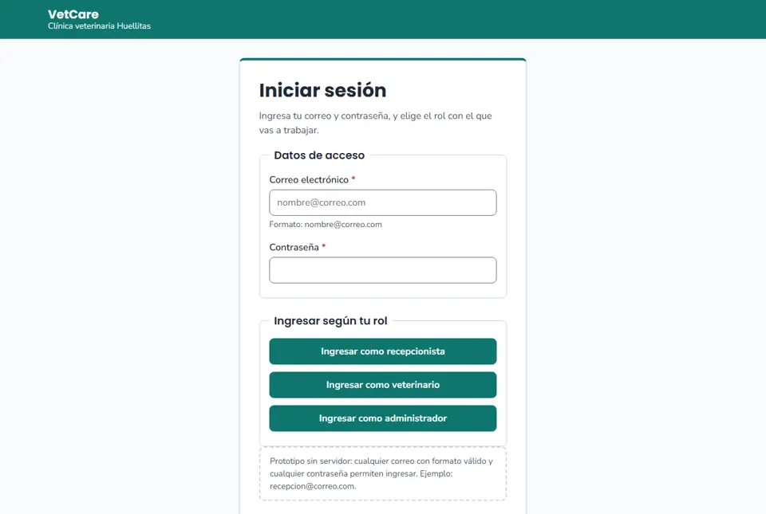
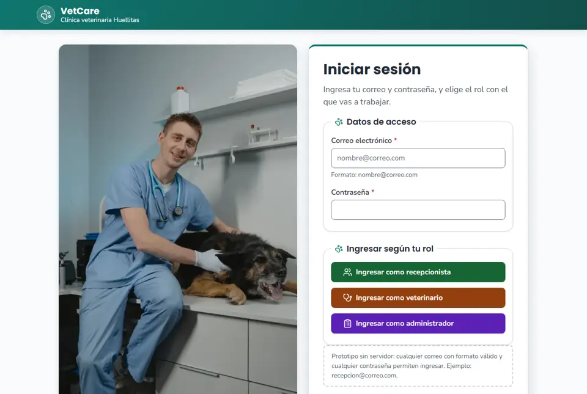
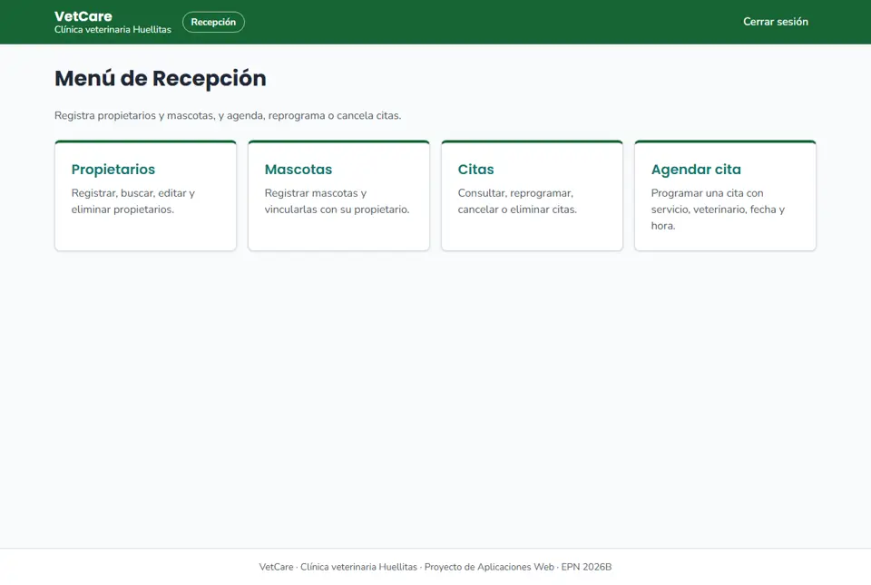
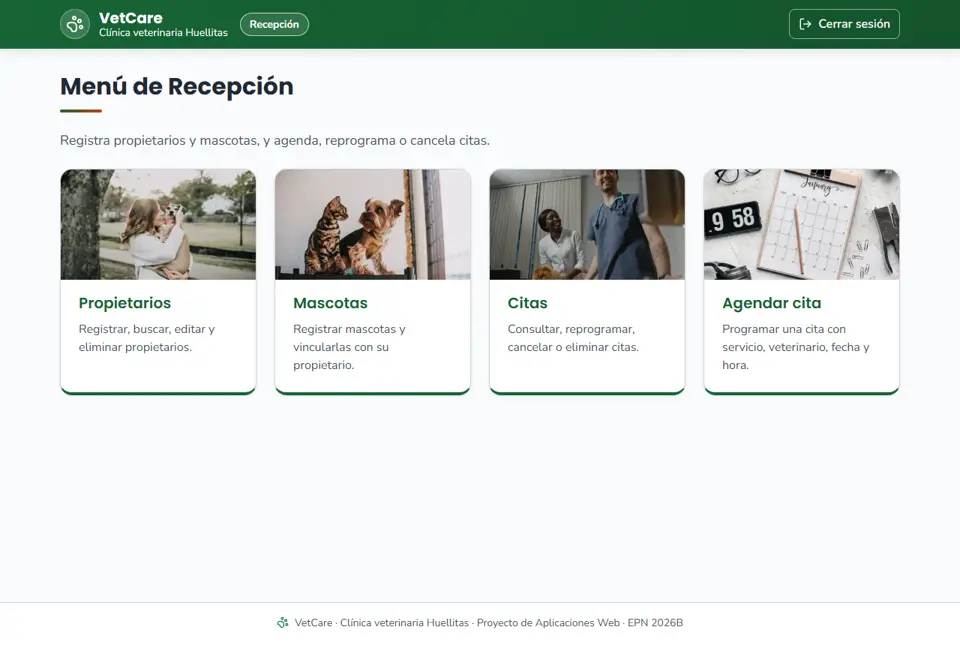
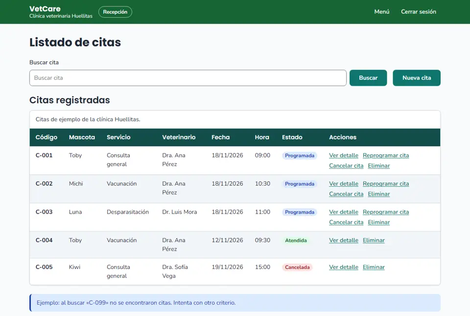
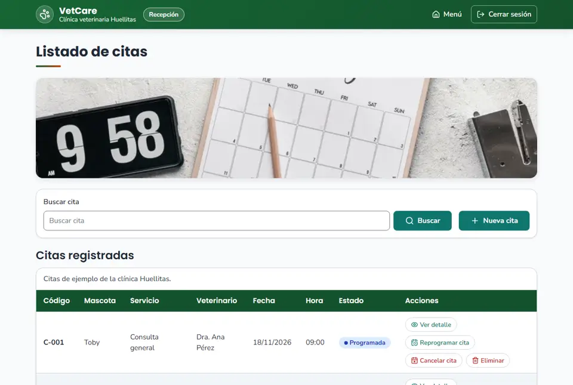

# Análisis de experiencia de usuario y mejora de la interfaz

**Proyecto:** VetCare · Clínica veterinaria Huellitas
**Rama:** `feature/mejora-interfaz` (sale de `develop`)
**Fecha:** 18/11/2026
**Herramientas:** skill *ui-ux-pro-max* (sistema de diseño para "veterinary clinic healthcare" y lista de reglas UX por prioridad), validador oficial W3C (`vnu.jar`) y capturas con Chrome.

## 1. Alcance y reglas que se respetaron

La mejora es **solo visual y de usabilidad**. No cambia el proyecto:

- **No hay pantallas nuevas.** Las 34 son las del mapa navegacional.
- **No cambia la navegación.** Un script comparó, en las 34 páginas y antes y después, los 608 elementos que definen la navegación y la validación: `href`, `action`, `formaction`, `method`, `name`, `id`, `required`, `pattern`, `min`, `max`, `step`, `minlength`, `maxlength`, `placeholder` y `value`, más el texto de cada `<a>` y `<button>`. El resultado fue **idéntico**.
- **Solo HTML5 y CSS3.** No hay JavaScript, frameworks ni pasos de build. Las imágenes son archivos locales en `img/`.
- **En el HTML solo se agregaron etiquetas ``** (y un `div` contenedor en el login). Todos los iconos se ponen desde CSS con `::before`.

## 2. Diagnóstico (estado de `develop` antes de la mejora)

| # | Área | Problema encontrado | Regla UX (prioridad) |
|---|---|---|---|
| 1 | Identidad | Sin logo ni imágenes (`img/` solo tenía `.gitkeep`); la marca era solo texto | Style selection (alta) |
| 2 | Menús de rol | Tarjetas de solo texto. El foco del teclado marcaba únicamente el texto del enlace, aunque toda la tarjeta es clicable | `focus-states` (crítica) |
| 3 | Login | Tarjeta aislada en una página vacía; los 3 botones de rol eran idénticos | Jerarquía visual |
| 4 | Avisos | `.aviso--info` y `.aviso--error` solo se distinguían por el color | `color-not-only` (crítica) |
| 5 | Tablas | Enlaces de acción pequeños y todos iguales: «Eliminar» se veía igual que «Ver detalle»; horas y códigos sin cifras tabulares | `touch-target-size`, `destructive-emphasis`, `number-tabular` |
| 6 | Formularios | Checkbox y radio pequeños; difícil ver de un vistazo qué días u opciones están marcados | `touch-target-size`, `state-clarity` |
| 7 | Navegación | «Cerrar sesión» se veía igual que «Menú», sin separación visual | `destructive-nav-separation` |
| 8 | Movimiento | No respetaba `prefers-reduced-motion`; el salto a `#atencion-N` era brusco | `reduced-motion` |
| 9 | Móvil | Los botones de `.acciones` no aprovechaban el ancho en pantallas de 375 px | `touch-density` |

## 3. Dirección de diseño

El sistema de diseño que propone la skill para una clínica veterinaria es *teal* de confianza con un acento cálido, esquinas suaves y sombras ligeras. Se aplicó así:

- **Se conserva la paleta.** `--c-primario: #0f766e` ya era el *teal* recomendado, y se mantienen los colores por rol (verde para recepción, ámbar para veterinario y violeta para administración).
- **Acento cálido nuevo:** `--c-acento: #c2410c`. Solo se usa en la barra decorativa bajo cada `h1`.
- **Se conservan las fuentes** Poppins (títulos) y Nunito Sans (texto): ya están en el `<head>` de las 34 pantallas.
- **Del estilo *claymorphism* se tomaron solo los radios grandes y las sombras suaves.** El estilo completo es demasiado infantil para un sistema de gestión interno.

### Tokens nuevos en `:root`

| Token | Valor | Uso |
|---|---|---|
| `--c-acento` | `#c2410c` | Barra bajo el `h1` |
| `--c-primario-suave` | `#ccfbf1` | Hover de las píldoras y halo del foco |
| `--c-rol-osc` / `--c-rol-suave` | Por rol | Degradado del encabezado, `thead`, hover de filas, chips marcados, `:target` |
| `--c-error-osc` | `#7f1d1d` | Hover de acciones destructivas |
| `--radio-lg`, `--radio-pildora` | `1rem`, `999px` | Tarjetas, tablas, fieldsets, píldoras |
| `--sombra-md`, `--sombra-lg` | — | Escala de elevación (antes había una sola sombra) |
| `--transicion-rapida` | `150ms ease-out` | Pulsación de botones |

## 4. Cambios por componente

| Componente | Mejora | Resuelve |
|---|---|---|
| Encabezado | Logo de huella (`.marca::before`), degradado del color del rol, iconos en «Menú» (casa) y «Cerrar sesión» (salida, con borde propio) | 1, 7 |
| `h1` | Barra de acento con el color del rol hacia el naranja | 1 |
| Menús de rol | Foto en cada tarjeta, elevación al pasar el cursor y contorno en **toda la tarjeta** con el teclado (`li:has(a:focus-visible)`) | 1, 2 |
| Login | Foto de la clínica a la izquierda (desde 1024 px) o arriba (en móvil); cada botón de rol con su color e icono, elegidos con `button[formaction$="…"]` | 1, 3 |
| Pantallas de entrada de módulo | Foto panorámica bajo el `h1` (`.portada-modulo`), con encuadre ajustado por foto | 1 |
| Barra de herramientas | Tarjeta blanca; lupa en «Buscar» y «+» en «Nuevo …» | 1 |
| Tablas | `thead` con el color del rol; filas con hover tenue; código en negrita; cifras tabulares | 5 |
| Acciones de fila | Píldoras de 32 px de alto con icono según el destino (detalle, editar, reprogramar, registrar atención, historial); **«Eliminar» y «Cancelar cita» en rojo y con su propio icono** | 5 |
| Estado de cita | Punto de color además del texto | 4 |
| Formularios | `fieldset` como tarjeta; huella en el `legend`; halo de foco; borde punteado en los campos `readonly` | 6 |
| Checkbox y radio | Cada opción es un *chip* de 44 px; el marcado se resalta con `label:has(:checked)` | 6 |
| Avisos | Icono según el tipo: alerta (`.aviso`), error (`--error`), información (`--info`) y éxito (`--exito`) | 4 |
| Fichas | Etiquetas `dt` en versalitas grises y valores en negrita, más fáciles de escanear | — |
| Historial clínico | El artículo destino de `#atencion-N` se resalta con un destello animado; hay más aire entre artículos | 8 |
| Botones en móvil | En `.acciones` ocupan todo el ancho bajo 640 px; desde tablet vuelven a su ancho natural | 9 |
| Movimiento | `scroll-behavior: smooth` solo con `prefers-reduced-motion: no-preference`; con `reduce` se anulan transiciones, animaciones y zoom | 8 |

## 5. Imágenes

- **9 fotos** de Pexels (licencia libre) en WebP, de 18 a 88 KB cada una (324 KB en total). Todas llevan `width` y `height` para evitar saltos de diseño, y las de los menús usan `loading="lazy"`.
- **Textos alternativos:** la foto del login tiene `alt` descriptivo. Las fotos de los menús y portadas usan `alt=""`, porque son decorativas y el título de la tarjeta o el `h1` ya dice lo mismo; así el lector de pantalla no repite.
- **23 iconos** de Lucide (licencia ISC) en variantes de color.
- Los créditos están en `img/CREDITOS.md` y en `README.md`.

## 6. Verificación

| Prueba | Resultado |
|---|---|
| Validador W3C (`vnu.jar`), 34 páginas HTML | 0 errores, 0 advertencias |
| Validador W3C de CSS (`vnu.jar --css`), `estilos.css` | 0 errores, 0 advertencias |
| Huella de navegación (608 elementos) antes y después | Idéntica |
| Rutas de todas las imágenes (`src` y `url()`) | Todas existen |
| Contraste de los 26 pares de color nuevos | Todos ≥ 4.5:1 (mínimo 4.61; texto sobre fondos suaves ≥ 12:1) |
| Capturas en Chrome a 1280 px y en un iframe de 375 px | Sin desbordamiento horizontal |
| Firefox | Pendiente de revisar a mano (`:has()` necesita Firefox 121 o superior) |

## 7. Antes y después

| Antes | Después |
|---|---|
|  |  |
|  |  |
|  |  |

## 8. Archivos tocados

- `css/estilos.css`: todos los cambios de estilo; se mantienen las mismas secciones y se agrega la 11 (movimiento reducido).
- `index.html` y los 3 menús (Integrante 1).
- Imagen bajo el `h1` de: `propietarios-listado` (I1); `mascotas-listado` y `citas-listado` (I2); `agenda-dia`, `historial-clinico`, `veterinarios-listado` y `servicios-listado` (I3). En los archivos de I2 e I3 el cambio es una sola línea `` por archivo, y conviene que sus dueños lo revisen en el PR.
- Archivos nuevos: `img/fotos/`, `img/iconos/`, `img/CREDITOS.md`, `docs/capturas/` y este documento.
- `docs/PLAN_IMPLEMENTACION.md` (sección 4.3, catálogo) y `README.md` (créditos).
